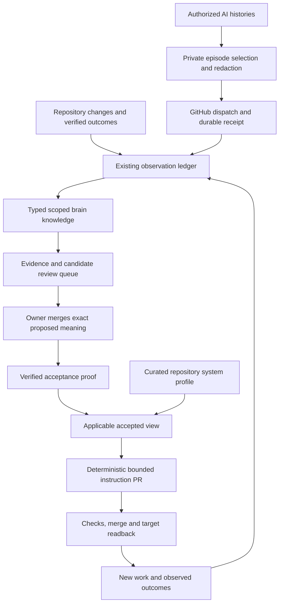

# Repository administration from the brain

Owner approval: `brain-repository-administration-v1`, 2026-10-17.

The brain maintains operating knowledge for each admitted repository. Entry
instructions deliver a small applicable view. Repository code, current state,
native feedback and experiment records remain the source of product truth.



## Evidence, interpretation and authority

`state/observations/*.jsonl` remains append-only. Version 2 episode envelopes
retain opaque session/event identity, a registered repository or `null`, the
goal, retained decisions, requested change, attempt, reported outcome,
conditions and uncertainty. They never grant approval. Raw histories remain
at their authorized source; redaction precedes model extraction.

`brain/knowledge.jsonl` adds typed, versioned records to the existing brain:
fact, requirement, preference, procedure, experiment, hypothesis and working
decision. Every record has explicit scope and status. Observations and
candidates are machine-written evidence interpretations. Accepted content is
bound by hash to the approved initial plan or to a verified owner merge.
Refinement, contradiction and supersession preserve earlier history.

The effective view first filters applicability, then resolves accepted
supersession. Unknown scope cannot enter a repository view. Conflicting
accepted records stop delivery. Workflow records stay labelled; conditions
and uncertainty survive rendering. Experiments do not become instructions.

`repository-reviews.mjs` routes earned local candidates into draft review PRs,
sharing the existing three-decision budget with canon proposals. It cannot
change knowledge, policy or runtime files. A candidate includes rationale,
alternative explanation, risk if wrong, validation and rollback. Only an
actual merge by `krishanraja` accepts its exact scoped meaning. The promotion
worker checks the merge actor, changed-file boundary, append-only record,
merge revision and content hash. The publisher never approves new meaning.

## Whole-repository administration

`brain/repositories/*.json` describes entry routes, system sources, workflows,
verification commands and bootstrap budgets. It contains references, not
private product records or copied commercial facts. Profiles are curated
under the approved inventory; scheduled jobs never blindly regenerate them.
A source missing or moving ambiguously blocks its target rather than causing
a guessed replacement.

The content profile covers ideation/drafting, iteration, production and board
continuity. The growth profile covers research, evidence, packet handoffs and
conditional experiments. The other profiles route current-state orientation
and verification through their own repository sources.

An iterative working brief retains the goal and accepted decisions while
applying a requested delta. A shorter title must still meet the agreed subject
and argument. Soft goals can trade off; an explicit owner decision can
supersede a named requirement. A failed growth test retains its conditions
and unknown cause, and does not prohibit another test or another repository.
These are administration procedures, not invented editorial preferences.

## Ownership and size

- Canon sync owns only `krish-canon` regions.
- This publisher owns `krish-repo-admin` in `AGENTS.md` (400 words maximum),
  the complete generated `docs/HARNESS_CONTEXT.md` (1,200 words maximum), and
  `.github/workflows/harness-repository-context.yml`.
- `CLAUDE.md` routes to `@AGENTS.md`. An initial hash-bound migration may
  compress duplicated boilerplate while retaining unique rules. Subsequent
  runs preserve unmanaged bytes exactly.
- The docs steward cannot change, archive or regenerate those owned regions
  or files. Its validator checks this even if a writer recalculates hashes.

Bootstrap measurement follows both entry files, native imports and explicit
mandatory startup reads, counting each reachable file once. Task references
remain on demand. The migration must not grow measured startup context.
This is a deterministic character measure, not a claim about a client's
actual tokenization or undocumented loading behaviour.

The admission contract names ten targets, with content engine and AEO as
pilots. `mindmake` is excluded before any new-writer request. New fleet entries
are not automatically admitted. The writer changes at most four declared
files, requires a successful measured check before merge, rereads the exact
head/base, and verifies every delivered file after merging. Human drift,
unknown branches, source changes and unresolved accepted conflicts stop that
target. No application actions, publishing, sends, spending or permissions
are authorized by a generated guide.

## GitHub operation

`repository-administration.yml` runs on GitHub-hosted runners after intake,
after relevant accepted-source changes, nightly, and on manual dispatch. It
checks trusted main for mutations, consolidates evidence, verifies owner
acceptances and reconciles instruction PRs. Weekly proposal interpretation
uses the existing Anthropic API access with no writer credential and
restricted output paths. Deterministic scripts alone hold `FLEET_TOKEN`.

No database, exporter service, local PC or new package is required. Existing
GitHub and AI credentials remain necessary. The hosted exporter is optional;
missing configuration reports a coverage gap without stopping independent
GitHub intake. A configured exporter failure remains visible in Actions.

History-source coverage is independent of core availability. The existing
standing Claude cloud session can supply authorized history via its own
tools; local history adapters are optional. GitHub cannot read a provider's
unexposed chat history. Missing account enumeration, pagination or source
metadata remains unverified until that adapter supplies evidence. Do not
report complete Claude or Codex history coverage from delivered counts.

The miner saves a pending redacted interpretation before submission. It
replays the same bytes until identity and payload match the durable ledger on
GitHub main. Dispatch HTTP success alone never advances a cursor. Capped or
failed extraction leaves unprocessed source episodes replayable. Cloud
timestamps include event identities so equal timestamps cannot drop events.
Receipt-bound opaque cloud checkpoints also live in GitHub. A fresh worker
recovers only progress whose referenced observation payloads match the same
pinned main revision. Malformed or partial model output cannot become an
empty interpretation.

## Local checks and read-only previews

```sh
node scripts/validate-repository-brain.mjs
node scripts/test-repository-learning.mjs
node scripts/repository-brain.mjs --repo content-engine --workflow content
node scripts/repository-admin.mjs --repo content-engine --checkout ../content-engine
```

`repository-admin --write` writes only a local checkout. The remote writer
requires its explicit `--write`; `--merge` additionally requires successful
checks and exact source/head readback. A no-change view creates no update.

`state/repository-administration/latest.json` records delivery status, source
base, brain revision, startup measure and target PR. Successful deployments
retain their prior base and changed paths for rollback in Git history and
the deployment ledger. `health.json` derives received episode counts and
coverage, keeping missing opportunities and effectiveness unknown.
It also consumes the bounded [measurement handoff](repository-measurements.md)
through the same intake. The scheduled verifier checks source hashes, exact
job attestations or owner merges, delivered bytes and brain revisions before
counting observed loading, application checks or comparable opportunities.
Source failures, unverified reports and synthetic evaluations remain distinct.

## Validation and effectiveness

The [2026-10-17 rollout report](repository-administration-rollout-2026-10-17.md)
records the initial merged targets, exact readbacks, fresh Claude fixtures and
rollback evidence. Its observations are pinned to the recorded revisions.

Deterministic regressions cover retained intent, source isolation, scope,
deduplication, receipt conflicts, experiment uncertainty, approval binding,
human drift, budgets, exclusion, atomic commits and rollback. Fresh Claude
fixture runs exercise orientation and iteration for both pilots, pinning the
source and brain revisions and requiring observed Read tool calls for the
entry route and context. They certify those fixture behaviours only. They do
not establish production loading, Codex parity, subjective title quality or
long-term effectiveness.

The additional native-title replay reads pinned accepted/rejected examples
and the actual correction sequence privately in memory. It preserves the
accumulated brief, resolves the explicit supersession, compares competing
qualities and retains surface-specific approval boundaries. Only opaque
hashes, IDs and bounded evaluation results enter public logs. This supplements
the fresh-context fixture; model comparison does not certify personal taste.

Measure repeated avoidable corrections only against relevant opportunities
under comparable conditions. Diagnose missing evidence, interpretation,
scope, retrieval, freshness, ignored guidance, code defects and deliberate
experiments separately. A repeated defect in the owning application becomes
a linked finding; adding another instruction is not an automatic repair.

## Rollback

Use the deployment receipt's repository, `merge`, `rollback.base` and paths.
`rollbackRepository` reads prior, delivered and current bytes and creates a
rollback PR. It restores only the prior managed delta, preserves intervening
human text when unambiguous, and refuses drift or an ambiguous migration.
The same checks and exact-head merge/readback gates apply. Immutable evidence
and accepted decision history remain. To stop future publishing, disable
this named workflow; do not erase evidence or reset a target branch.

Read-only rollback preview: `node scripts/reconcile-repository-admin.mjs
--rollback receipt.json`. Add `--write` to open the guarded rollback PR, then
use its passing checks, expected head and merged target readback to complete
the authorized rollback.
